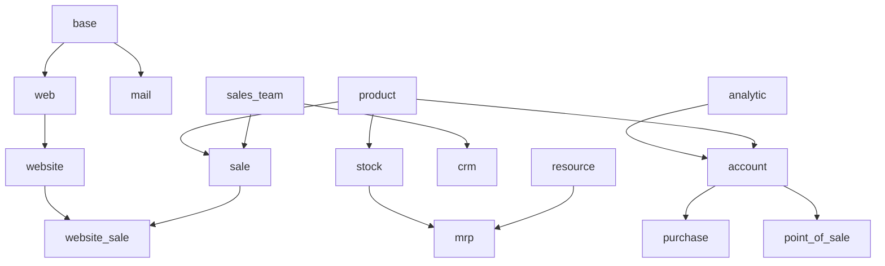

# Addon catalog and dependency domains

> Snapshot: source branch `20.0`, commit `065e742f0c1b1f9dabe9605eb576c8c077c6ab43`.

## How to read an addon

An addon manifest (`__manifest__.py`) declares dependencies, XML data, demo data, security, assets, hooks and application metadata. Python models are usually imported from `models/__init__.py`. The final model for a database is the combination of model classes contributed by every installed addon through `_inherit` and `_inherits`; one addon file alone may not describe its runtime behavior.

Typical addon structure:

```text
addon/
  __manifest__.py
  models/       Python model declarations/extensions
  controllers/  HTTP routes
  views/        XML views, actions and menus
  data/         XML/CSV records, sequences, cron definitions
  security/     ACLs and record rules
  wizard/       transient workflows
  report/       report actions and QWeb templates
  static/src/   JS, XML templates, SCSS and CSS
  tests/        Python and frontend tests
```

## Business-domain map

| Domain | Representative addons | Main responsibility |
|---|---|---|
| Foundation | `base`, `web`, `mail`, `bus`, `portal` | Identity, ORM metadata, UI, messages, realtime, portal |
| CRM | `crm`, `sales_team`, `utm` | Leads, opportunities, pipeline and attribution |
| Sales | `sale`, `sale_*`, `website_sale` | Quotes/orders, customer checkout and invoice handoff |
| Finance | `account`, `account_*`, `analytic`, `payment`, `payment_*` | Invoices, journals, tax, reconciliation, EDI and providers |
| Procurement | `purchase`, `purchase_*` | RFQs, supplier orders, receipt and bill matching |
| Logistics | `stock`, `stock_*`, `delivery`, `barcodes` | Moves, pickings, locations, quants and routes |
| Manufacturing | `mrp`, `mrp_*` | BOMs, production orders, operations and work centers |
| Projects | `project`, `project_*`, `hr_timesheet` | Projects, tasks, billable time and delivery |
| HR | `hr`, `hr_*`, `resource` | Employees, calendars, attendance, time off, expenses, recruitment |
| Website/content | `website`, `website_*`, `theme_*` | Sites, pages, menus, snippets, blog, events and eCommerce |
| Retail | `point_of_sale`, `pos_*` | POS configs, sessions, orders, payments, stock and accounting |
| Localizations | `l10n_*` | Country charts, statutory tax, EDI and reports |
| Integration tests | `test_*`, `*_test` | Cross-addon behavior and regression scenarios |

## Example dependency paths



This is a conceptual subset, not the complete dependency graph. Always inspect the exact manifest for an addon and its transitive dependencies.

## Verified manifest examples

- `account` depends on `base_setup`, `onboarding`, `product`, `analytic`, `portal`, `digest`.
- `sale` depends on `sales_team`, `account_payment`, `utm`.
- `purchase` depends on `account`.
- `stock` depends on `product`, `barcodes_gs1_nomenclature`, `digest`.
- `mrp` depends on `product`, `stock`, `resource`.
- `crm` depends on `sales_team`, `mail`, `calendar`, `resource`, `utm`, `contacts` and other common modules.
- `project` depends on `analytic`, `mail`, `portal_rating`, `resource`, `web` and related infrastructure.
- `hr` depends on signup, phone validation, resource-mail and hierarchy infrastructure.
- `website` depends on `web`, `html_editor`, `http_routing`, `portal`, `mail`, `auth_signup`, `utm` and `html_builder`.
- `point_of_sale` depends on `resource`, `product`, `account`, barcode nomenclature, HTML editor and IoT web serial.

## Bridge addons

Optional integration addons connect otherwise distinct domains. Examples include `sale_stock` (sales and delivery), `purchase_stock` (supplier orders and receipts), `stock_account` (inventory valuation and accounting), `mrp_account` (manufacturing costing), `sale_project` (sales and project delivery), `sale_timesheet` (billable time), `pos_stock` (retail inventory), and `website_sale` (website checkout and sales). Check whether the bridge addon is installed before assuming a relation or side effect exists.

## Localization pattern

Country addons under `l10n_*` commonly depend on `account` and may add chart/tax data, statutory reports, EDI formats, field validations or `_inherit` extensions to accounting and partner models. A core model change should be checked against relevant localization extensions and tests.

## Source evidence

- [account manifest](https://github.com/T4AI-ORG/odoo-20.0/blob/065e742f0c1b1f9dabe9605eb576c8c077c6ab43/addons/account/__manifest__.py)
- [sale manifest](https://github.com/T4AI-ORG/odoo-20.0/blob/065e742f0c1b1f9dabe9605eb576c8c077c6ab43/addons/sale/__manifest__.py)
- [purchase manifest](https://github.com/T4AI-ORG/odoo-20.0/blob/065e742f0c1b1f9dabe9605eb576c8c077c6ab43/addons/purchase/__manifest__.py)
- [stock manifest](https://github.com/T4AI-ORG/odoo-20.0/blob/065e742f0c1b1f9dabe9605eb576c8c077c6ab43/addons/stock/__manifest__.py)
- [mrp manifest](https://github.com/T4AI-ORG/odoo-20.0/blob/065e742f0c1b1f9dabe9605eb576c8c077c6ab43/addons/mrp/__manifest__.py)
