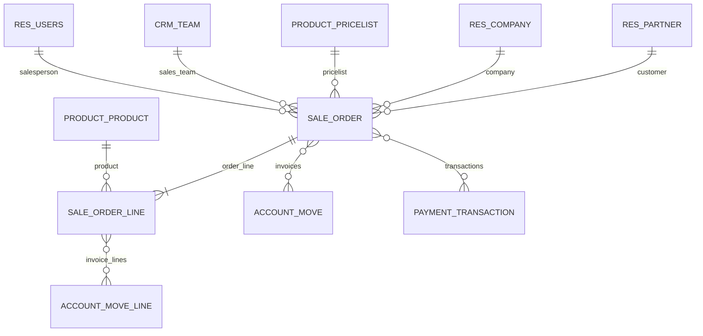
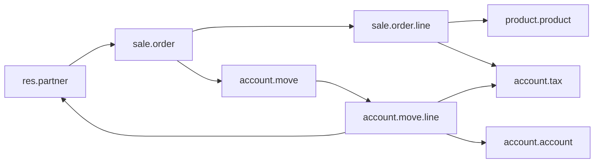

# Core Model Relationships

## Base models

### `res.partner`

`res.partner` is the foundational identity model for people and organizations.

Important relationships:

- parent/child contacts: `parent_id` → `res.partner`, `child_ids`;
- commercial entity: `commercial_partner_id`;
- salesperson: `res.users`;
- company: `res.company`;
- country/state: `res.country` / `res.country.state`;
- bank accounts: `res.partner.bank`;
- categories/tags: `res.partner.category`;
- users linked to a partner: `res.users.partner_id`;
- industry: `res.partner.industry`.

Its commercial fields and address fields synchronize between a contact and its parent/commercial entity.

### `res.company`

`res.company` defines the organizational tenancy boundary for a model or record. It links to:

- `res.partner`;
- currency;
- country;
- chart of accounts/accounting configuration;
- parent/child company branches;
- default accounting journals and users.

### `res.users`

`res.users` represents login identities and links to:

- `res.partner`;
- companies and main company;
- security groups;
- company/branch configuration;
- user settings and devices.

## Core infrastructure models

| Model | Role |
|---|---|
| `ir.module.module` | Installed module state and dependencies |
| `ir.model` | Registered model metadata |
| `ir.model.fields` | Field metadata and type reflection |
| `ir.model.data` | XML external IDs and record identity |
| `ir.ui.view` | UI and report view XML |
| `ir.ui.menu` | Menu hierarchy |
| `ir.actions.*` | Windows, reports, servers and URLs |
| `ir.attachment` | Stored files and binary metadata |
| `ir.cron` | Scheduled jobs |
| `ir.sequence` | Document numbering |
| `ir.rule` | Record rules |
| `ir.access` | Model CRUD ACLs |

## Accounting relationships

### `account.move`

`account.move` is the journal entry/invoice/bill record.

Important relationships:

- journal: `account.journal`;
- company and currency;
- partner/commercial partner;
- shipping partner;
- fiscal position;
- payment terms;
- journal items: `account.move.line`;
- bank statement line;
- origin/reversed moves;
- payments;
- PDF and import attachments.

### `account.move.line`

`account.move.line` is a line of an accounting entry. It links to:

- `account.move`;
- `account.account`;
- partner;
- currency;
- taxes and tax repartition;
- product;
- analytic distributions;
- reconciliations;
- sale/purchase order lines when integrated.

### `account.journal`

`account.journal` defines where accounting entries are posted. It links to:

- company;
- default debit/credit or main account;
- bank account;
- invoices and journal entries;
- sequence configuration;
- payment method lines.

## Sales relationships

### `sale.order`

Important fields:

- `partner_id`, `partner_invoice_id`, `partner_shipping_id`;
- `company_id`, `currency_id`, `pricelist_id`;
- `order_line` → `sale.order.line`;
- `invoice_ids`/invoice lines;
- `transaction_ids`;
- `team_id`, `user_id`, `campaign_id`, `medium_id`, `source_id`;
- payment terms and fiscal position;
- computed totals and delivery/invoice status.

### `sale.order.line`

A sales order line connects to:

- `sale.order`;
- product template and product variant;
- unit of measure;
- taxes;
- analytic account/distribution;
- invoice lines;
- optional delivery/subsections and combo products.

## Partner, sale and accounting chain

## Evidence

- [`odoo/addons/base/models/res_partner.py`](https://github.com/T4AI-ORG/odoo-20.0/blob/065e742f0c1b1f9dabe9605eb576c8c077c6ab43/odoo/addons/base/models/res_partner.py)
- [`addons/sale/models/sale_order.py`](https://github.com/T4AI-ORG/odoo-20.0/blob/065e742f0c1b1f9dabe9605eb576c8c077c6ab43/addons/sale/models/sale_order.py)
- [`addons/account/models/account_move.py`](https://github.com/T4AI-ORG/odoo-20.0/blob/065e742f0c1b1f9dabe9605eb576c8c077c6ab43/addons/account/models/account_move.py)
- [`addons/account/models/account_move_line.py`](https://github.com/T4AI-ORG/odoo-20.0/blob/065e742f0c1b1f9dabe9605eb576c8c077c6ab43/addons/account/models/account_move_line.py)
