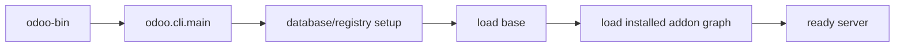
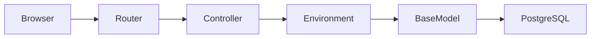
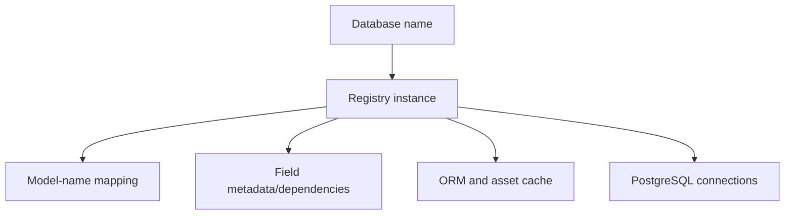

# Odoo 20.0 — Quick Architecture Cards

## Core cards

### Server startup

### One HTTP request

### One registry

## Foundational model card

- `res.partner`: identity/commercial/contact model
- `res.company`: organizational scope
- `res.users`: login identity and access scope
- `res.currency`: currency and conversion
- `res.country` / `res.country.state`: geographical data
- `ir.module.module`: module state
- `ir.model` / `ir.model.fields`: model metadata
- `ir.attachment`: file storage
- `ir.cron`: scheduled jobs

## Business model cards

### Sales

- `sale.order` = quotation/sales order header
- `sale.order.line` = sale order detail
- relationships: partner, company, pricelist, taxes, product, invoice, payment, stock

### Accounting

- `account.move` = journal entry/invoice/bill
- `account.move.line` = journal entry line
- relationships: partner, journal, account, tax, currency, reconciliation, payment

### Inventory

- `stock.picking` = transfer/document
- `stock.move` = product movement
- `stock.move.line` = detailed lot/location quantity
- `stock.quant` = on-hand quantity
- relationships: location, product, warehouse, order, valuation

### Purchase

- `purchase.order` = supplier order header
- `purchase.order.line` = purchase detail
- relationships: partner, product, tax, stock, account move

### Manufacturing

- `mrp.production` = manufacturing order
- `mrp.bom` = recipe
- `mrp.bom.line` = component recipe line
- `mrp.workorder` = operation
- relationships: stock, work center, sale/purchase/project

## Human/AI agent guidance

Before changing code:

1. identify addon by manifest;
2. find `_name`, `_inherit`, `_inherits`;
3. find field dependencies and constraints;
4. trace related add-on manifest dependencies;
5. inspect tests;
6. update XML/views/security if model behavior changes;
7. account for multi-company and access rights;
8. use migration scripts for upgrade changes;
9. preserve existing external IDs and actions;
10. update this documentation for stable architectural changes.
