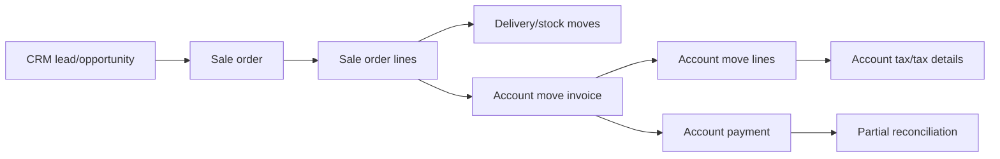
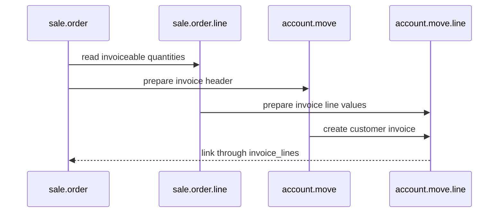
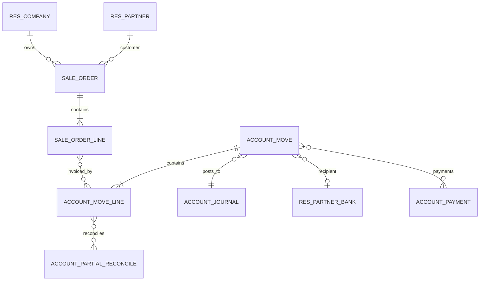

# Sales to Accounting Flow

## Business pipeline

## Creating a quotation

`sale.order` is the document-level model. `sale.order.line` is the product/section/notes line model.

A sales order resolves:

- customer and invoice/delivery addresses;
- company and currency;
- pricelist and fiscal position;
- payment term and preferred payment method;
- salesperson and sales team;
- tax and delivery information.

Key source: [`addons/sale/models/sale_order.py`](https://github.com/T4AI-ORG/odoo-20.0/blob/065e742f0c1b1f9dabe9605eb576c8c077c6ab43/addons/sale/models/sale_order.py).

## Quotation to sales order

`action_confirm()` validates analytic distributions, writes the sale state and confirmation date, then executes `_action_confirm()`. The sale addon may lock the order according to configuration.

Downstream modules may override `_action_confirm()` to create deliveries, tasks, subscriptions or manufacturing documents.

## Sales line to invoice

The sale addon computes `invoice_status` from `sale.order.line.invoice_status` and creates invoices with `_create_invoices()`.

For each sale order:

1. `_prepare_invoice()` builds `account.move` values.
2. `_get_invoiceable_lines()` selects lines to invoice.
3. `_prepare_invoice_lines_vals_list()` prepares invoice move-line values.
4. `_create_account_invoices()` creates the `account.move` records.
5. Sale-to-invoice relations are established through `sale.order.line.invoice_lines` and the many-to-many line relation.

## Accounting integration

`account.move` represents the invoice. `account.move.line` stores the journal entries and accounting impact.

Typical invoice links:

- `account.move.partner_id` → `res.partner`;
- `account.move.partner_invoice_id` → invoice address;
- `account.move.partner_shipping_id` → delivery address;
- `account.move.fiscal_position_id` → `account.fiscal.position`;
- `account.move.invoice_line_ids` → product invoice lines;
- `account.move.line_ids` → all journal items;
- `sale.order.line.invoice_lines` → invoice lines.

## Totals and taxes

The sale order and account move both calculate totals from base tax lines and tax details.

`sale.order._compute_amounts()`:

- reads priced `sale.order.line` records;
- prepares account-tax base lines;
- includes early-payment discount base lines;
- adds tax details;
- rounds tax details;
- computes untaxed, tax and total amounts.

`account.move._compute_amount()` derives totals from posted and draft journal items, as well as tax/payment-term lines.

## Payments and reconciliation

Payment transactions may be linked to `sale.order.transaction_ids`. An invoice can be linked to reconciled payments through `account.move.reconciled_payment_ids`.

Payment status is derived from:

- `amount_residual`;
- reconciled partner lines;
- matched payments;
- bank transaction lines;
- credit/debit reversals.

## Cancellation and refund

Cancelling a draft or locked sales order differs from cancelling an invoice:

- sale cancellation changes `sale.order.state` to `cancel` and cancels linked draft invoices;
- invoice reversal creates an opposite `account.move` through `TYPE_REVERSE_MAP`;
- posted sales invoices may require credit notes instead of direct deletion;
- posted journal entries are protected by locks and audit-trail settings.

## Core cross-domain diagram

## Source evidence

- [`addons/sale/models/sale_order.py`](https://github.com/T4AI-ORG/odoo-20.0/blob/065e742f0c1b1f9dabe9605eb576c8c077c6ab43/addons/sale/models/sale_order.py)
- [`addons/account/models/account_move.py`](https://github.com/T4AI-ORG/odoo-20.0/blob/065e742f0c1b1f9dabe9605eb576c8c077c6ab43/addons/account/models/account_move.py)
- [`addons/account/models/account_move_line.py`](https://github.com/T4AI-ORG/odoo-20.0/blob/065e742f0c1b1f9dabe9605eb576c8c077c6ab43/addons/account/models/account_move_line.py)
